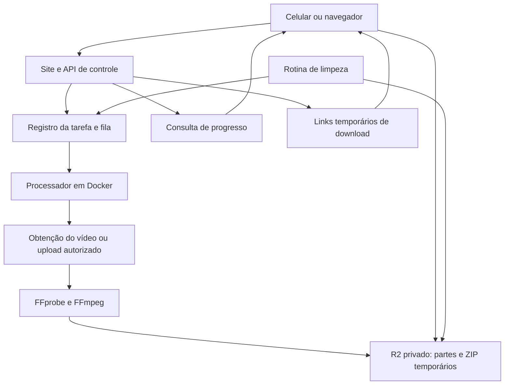

# Planejamento — site para dividir vídeos para o Status do WhatsApp

**Data:** 20 de outubro de 2026.  
**Entrega:** relatório de viabilidade, arquitetura, tecnologias, hospedagem e orçamento.  
**Escopo:** planejamento; não inclui implementação nem contratação de serviços.

## 1. Viabilidade e recomendação

**Sim, é possível desenvolver o site e utilizar Cloudflare ou Vercel.** A divisão dos vídeos é uma operação conhecida e bem atendida pelo FFmpeg. A principal incerteza é baixar o vídeo a partir de um link do Instagram ou do X: acesso público à publicação não garante acesso automatizado ao arquivo.

Recomendo um MVP com entrada por link, upload de arquivo como alternativa, processamento em segundo plano e downloads temporários. A primeira etapa deve testar a obtenção dos vídeos na infraestrutura real de produção, antes de investir na interface completa.

Para começar com custo previsível: **Cloudflare para interface e proteção, um pequeno servidor Linux com Docker para API e processamento, e R2 para os arquivos temporários**. Se a prioridade for reduzir a administração de servidores, usar Cloudflare Workers + Containers + R2 é uma alternativa inteiramente na Cloudflare. Vercel também atende bem à interface e à API de controle, com o processamento separado ou avaliado no Container Runtime.

Não são necessários inteligência artificial, GPU ou armazenamento permanente de vídeos.

## 2. Duração dos vídeos e experiência do usuário

### 2.1. Limite atual do Status

A documentação atual do WhatsApp informa que vídeos de Status podem ter **até 90 segundos**. Portanto, não convém fixar o produto em 60 segundos. Oferecer 90, 60 e 30 segundos permite atender também a situações de compatibilidade; validar os perfis em Android e iPhone antes do lançamento. Fonte: [Central de Ajuda do WhatsApp](https://faq.whatsapp.com/643144237275579/?cms_platform=iphone&locale=pt_BR).

Exemplo para um vídeo de 2 minutos:

| Perfil escolhido | Arquivos gerados |
| --- | --- |
| 90 segundos | Parte 1: 90 s; parte 2: 30 s |
| 60 segundos | Parte 1: 60 s; parte 2: 60 s |
| 30 segundos | Quatro partes de 30 s |

O número nominal de partes é `ceil(duração_total / duração_por_parte)`. A implementação deve considerar a precisão de quadros e áudio para não gerar partes acima do limite, nem arquivos extras de poucos milissegundos por arredondamento.

O site prepara arquivos independentes em sequência. O usuário os seleciona e publica no aplicativo do WhatsApp; não faz parte deste projeto publicar automaticamente no Status. A sequência pode apresentar as transições próprias do WhatsApp entre arquivos.

### 2.2. Fluxo proposto

1. O usuário cola um link do Instagram ou do X.
2. Escolhe a duração das partes; o padrão inicial pode ser 90 segundos, após validação em aparelhos reais.
3. O site informa os limites de uso e inicia a tarefa.
4. Exibe os estados: na fila, obtendo vídeo, processando, pronto ou falha.
5. Mostra as partes em ordem, com duração, tamanho, prévia e botão de download.
6. Oferece também um ZIP, quando útil, e informa o horário de expiração.
7. O usuário baixa os arquivos e os publica em ordem no WhatsApp.

Nomes sugeridos: `video-parte-01-de-03.mp4`, `video-parte-02-de-03.mp4` etc. Downloads individuais devem ser a opção principal em celulares, pois ZIP exige extração. A integração com o menu de compartilhamento do aparelho pode ser uma melhoria posterior, sujeita ao suporte do navegador.

### 2.3. Escopo inicial

| Item | Proposta para o MVP |
| --- | --- |
| Fontes | Publicação individual com vídeo no Instagram ou X |
| Alternativa | Upload de vídeo do aparelho se o link falhar |
| Duração máxima da origem | 10 minutos |
| Tamanho máximo da origem | 200 MB, medidos durante o recebimento |
| Qualidade inicial | Até 720p, preservando proporção e orientação |
| Saída | MP4 com vídeo H.264 e áudio AAC, quando existir áudio |
| Cortes | 30, 60 ou 90 segundos |
| Retenção dos resultados | 24 horas a partir da conclusão |
| Identificação | Sessão anônima com token secreto; sem cadastro inicial |
| Limites de uso | Uma tarefa ativa por sessão e cota inicial ajustável por IP/sessão |

Inicialmente, excluir transmissões ao vivo, Stories, perfis inteiros, contas privadas, conteúdo que exija login e publicações com múltiplos vídeos. Nesse último caso, retornar orientação clara ou permitir seleção em uma fase posterior. Não cortar a imagem para 9:16 automaticamente: preservar o enquadramento original.

## 3. Obtenção dos vídeos: a etapa de maior risco

### 3.1. Instagram

As APIs oficiais do Instagram são voltadas a integrações autorizadas com contas profissionais. Não devem ser tratadas como uma API universal de download de qualquer Reel de qualquer usuário. A coleção oficial da Meta distingue os acessos e informa limitações para contas pessoais. Fontes: [API com Facebook Login](https://www.postman.com/meta/instagram/folder/u4g5a2a/instagram-api-with-facebook-login) e [API com Instagram Login](https://www.postman.com/meta/instagram/folder/1z5vxzu/instagram-api-with-instagram-login).

Uma prova de conceito pode avaliar **yt-dlp**, que possui extratores para Instagram e Twitter/X. O próprio projeto informa que o suporte pode quebrar quando os sites mudam. Um extrator funcionar no computador do desenvolvedor não significa que funcionará com o IP de um servidor de hospedagem. Fonte: [sites suportados pelo yt-dlp](https://github.com/yt-dlp/yt-dlp/blob/master/supportedsites.md).

É necessário prever falhas por bloqueios, exigência de autenticação, indisponibilidade da publicação e alterações da plataforma. Não prometer “funciona com qualquer link”. Não solicitar senha nem cookies pessoais do usuário para sustentar a primeira versão.

### 3.2. X

Há duas rotas a avaliar: extrator compatível, com as mesmas limitações operacionais, ou API oficial, conforme acesso, campos disponíveis e permissões. A documentação contempla campos de mídia como `variants`; o protótipo deve confirmar a obtenção do arquivo para o tipo de publicação aceito. Referência de campos: [documentação de mídia nas respostas da API do X](https://docs.x.com/x-api/posts/english-language-firehose-stream).

Atualmente, a API oficial utiliza créditos por consumo e publica **US$ 0,005 por Post lido**. Se cada tarefa demandar uma leitura faturável, 10 mil tarefas originadas no X acrescentam aproximadamente US$ 50. Consultas adicionais e outras operações podem alterar a conta. Isso não garante permissão para redistribuição do vídeo. Fonte: [preços oficiais da API do X](https://docs.x.com/x-api/getting-started/pricing).

### 3.3. Estratégia recomendada

Criar uma camada substituível de obtenção de mídia: `InstagramProvider`, `XProvider` e `UploadProvider`. Isso permite trocar um extrator ou fornecedor sem reescrever a divisão dos vídeos.

Um fornecedor comercial de download pode reduzir trabalho de manutenção, mas precisa demonstrar estabilidade, cobertura, tratamento de dados e compatibilidade contratual com o serviço. Seus preços devem entrar como orçamento separado, após cotação. Não pressupor que terceirizar elimina bloqueios ou questões de autorização.

Para a prova de conceito, usar uma amostra de pelo menos 30 links por plataforma, de conteúdos próprios ou autorizados, com durações e formatos diferentes. Repetir em dias distintos e no provedor escolhido. Registrar taxa de sucesso, tempo, tamanho e motivo de falha. Uma meta inicial sugerida é obter pelo menos 95% de sucesso na amostra elegível; esse resultado não garante a mesma taxa em toda a plataforma.

## 4. Arquitetura e tecnologias

### 4.1. Fluxo técnico



O navegador envia a URL e recebe um identificador de tarefa; não fica aguardando toda a conversão em uma requisição longa. O processador busca a tarefa, baixa a origem, analisa, converte, divide, valida e publica os resultados. A interface consulta o progresso a cada poucos segundos.

Os arquivos são entregues diretamente pelo armazenamento mediante autorização temporária. Evitar encaminhar vídeos e ZIPs pelo servidor da interface, reduzindo uso de memória e tráfego intermediário.

### 4.2. Componentes sugeridos

| Componente | Tecnologia sugerida | Finalidade |
| --- | --- | --- |
| Interface | React + TypeScript + Vite | Aplicação simples, responsiva e estática |
| API em servidor Linux | Python + FastAPI | Criar tarefas e consultar resultados |
| API na Cloudflare | TypeScript + Hono em Workers | Alternativa à API em servidor |
| Processador | Python em Docker | Integração com obtenção de mídia e FFmpeg |
| Análise e conversão | FFprobe + FFmpeg | Medir e gerar arquivos compatíveis |
| Extração de links | yt-dlp ou fornecedor validado | Obter a mídia conforme disponibilidade |
| Arquivos | Cloudflare R2 Standard | Armazenamento temporário privado |
| Metadados | SQLite em VPS único ou D1 na Cloudflare | Estado, expiração e lista de partes |
| Fila | Tabela persistente no MVP em VPS; Queues na Cloudflare | Trabalho assíncrono e novas tentativas |
| Proteção | Turnstile e limites por sessão/IP | Reduzir automação abusiva e custos |
| Operação | Logs estruturados e alertas de falhas/gastos | Acompanhar estabilidade e consumo |

No VPS, uma tabela com reserva atômica da tarefa, prazo de reserva e recuperação após falhas evita introduzir Redis logo no início. Migrar para uma fila dedicada e PostgreSQL se houver vários processadores ou servidores. D1/SQLite guardam metadados, não os vídeos.

### 4.3. Processamento correto

O pipeline deve analisar codecs, orientação, duração e presença de áudio; normalizar timestamps; preservar a proporção; e produzir arquivos que comecem em um quadro decodificável de forma independente. Recomenda-se recodificação para H.264/AAC e pixel format `yuv420p`, com limites de resolução e bitrate.

Dividir apenas com cópia de streams (`-c copy`) é mais rápido, mas os cortes dependem dos keyframes e podem ultrapassar a duração desejada. Para cortes previsíveis, recodificar com keyframes nas fronteiras planejadas e validar cada resultado com FFprobe. Fontes: [segmentação no FFmpeg](https://ffmpeg.org/ffmpeg-formats.html#segment) e [opções de keyframes](https://ffmpeg.org/ffmpeg.html).

O critério de aceitação deve verificar que nenhuma parte exceda o perfil selecionado, que todo o conteúdo seja coberto e que não haja repetição, lacunas perceptíveis ou dessincronização. Uma pequena margem abaixo do teto pode ser aplicada se os testes em aparelhos indicarem necessidade; nesse caso, informar que a quantidade de partes pode aumentar em vídeos próximos a múltiplos exatos do limite.

Não há um tamanho máximo universal de arquivo assumido neste planejamento. Definir um orçamento de tamanho por parte e validar no WhatsApp real, ajustando bitrate e resolução. Para vídeo sem áudio, gerar saída sem trilha de áudio.

## 5. Cloudflare e Vercel

### 5.1. Comparação

| Opção | Hospedagem da interface/API | Processamento dos vídeos | Avaliação |
| --- | --- | --- | --- |
| Cloudflare + VPS | Assets/Pages na Cloudflare; FastAPI no VPS | Docker no VPS | Recomendação inicial para orçamento previsível e portabilidade |
| Tudo na Cloudflare | Assets + Workers | Cloudflare Containers | Boa opção gerenciada; validar custo por tarefa e acesso às fontes |
| Vercel + processador externo | React/Next.js e funções na Vercel | VPS ou serviço de containers | Conveniente para equipe familiarizada com Vercel |
| Vercel com Container Runtime | Interface e funções na Vercel | Container Runtime | Tecnicamente possível; avaliar beta, limites e custos antes de adotar |

### 5.2. Cloudflare

Workers comuns têm 128 MB de memória por isolate e limites de CPU. São adequados para validar pedidos, criar tarefas e emitir links, mas não são a escolha indicada para esse pipeline nativo de FFmpeg. Não confundir Workers com **Cloudflare Containers**, que permite executar ambientes Linux e ferramentas nativas. Fontes: [limites de Workers](https://developers.cloudflare.com/workers/platform/limits/) e [Cloudflare Containers](https://developers.cloudflare.com/containers/).

A opção inteiramente na Cloudflare usa Workers para controle, D1 para estado, Queues para despacho, Containers para processamento e R2 para os arquivos. O container deve interromper a ociosidade após concluir tarefas. Persistir estado e resultados fora dele e prever reinício de tarefas interrompidas.

O R2 Standard é adequado para retenção curta. Evitar Infrequent Access para arquivos descartáveis, pois essa classe tem retenção mínima de 30 dias. Fonte: [classes do R2](https://developers.cloudflare.com/r2/buckets/storage-classes/).

### 5.3. Vercel

Vercel atende à interface e às requisições pequenas da API. As funções têm limite de payload de 4,5 MB e, com Fluid Compute, duração máxima geral de 300 s no Hobby e 800 s no Pro/Enterprise; a documentação também descreve extensão beta até 1.800 s em configurações específicas. Uploads e downloads de vídeo devem ocorrer diretamente no armazenamento. Fonte: [limites de Vercel Functions](https://vercel.com/docs/functions/limitations).

A Vercel também oferece Container Runtime em beta, permitindo empacotar ferramentas em uma imagem OCI; os limites de Functions continuam aplicáveis. Assim, não é correto afirmar que FFmpeg seja impossível na Vercel. Para este MVP, o processador separado simplifica controle de concorrência e recuperação. Fonte: [Container Runtime](https://vercel.com/docs/functions/runtimes/container).

O Hobby é destinado a uso pessoal não comercial. Para um produto comercial, considerar o Pro, a partir de US$ 20/mês, acrescido de uso e eventuais assentos adicionais. Fontes: [preços](https://vercel.com/pricing) e [restrições do Hobby](https://vercel.com/docs/plans/hobby).

## 6. Retenção, privacidade e proteção do serviço

### 6.1. Exclusão dos arquivos

**Não apagar automaticamente no primeiro clique em “baixar”.** O navegador pode interromper, repetir ou solicitar partes do download; o servidor não consegue comprovar que o arquivo ficou salvo no aparelho.

Política proposta:

- Apagar a origem local assim que o processamento terminar e os resultados forem confirmados no R2.
- Manter partes e ZIP disponíveis por 24 horas após a conclusão, com prazo visível na interface.
- Oferecer “Excluir meus arquivos agora”, autorizado pela sessão proprietária.
- Rodar uma limpeza periódica por `expires_at`, incluindo temporários de tarefas com falha.
- Configurar lifecycle do R2 como proteção adicional contra arquivos órfãos e uploads incompletos.
- Manter metadados mínimos por até 7 dias para diagnóstico, sem guardar URLs completas ou nomes pessoais desnecessários; definir retenção de logs separadamente.

Lifecycle não é um agendamento preciso: o R2 informa que exclusões normalmente ocorrem até 24 horas após a expiração e podem levar mais tempo. Bloquear o acesso na aplicação no prazo informado e usar exclusão explícita para cumprir a política operacional. Fonte: [lifecycle de objetos](https://developers.cloudflare.com/r2/buckets/object-lifecycles/).

Usar bucket privado, links assinados curtos — por exemplo, 15 minutos, renováveis enquanto a tarefa estiver válida — e desativar cache público para resultados privados. Uma URL assinada já emitida pode continuar válida até expirar; exclusão imediata requer apagar os objetos. Remover o objeto não remove uma cópia já baixada pelo usuário nem uma cópia eventualmente mantida em cache. Fonte sobre cache: [consistência do R2](https://developers.cloudflare.com/r2/reference/consistency/).

### 6.2. Controles necessários

Validar domínios e formatos de URL; bloquear destinos locais, privados e serviços de metadados, inclusive após redirects e resolução DNS. O download de mídias e playlists também exige controle de destinos secundários e de redirecionamentos. Isso evita que o serviço seja usado para acessar a rede interna do servidor, vulnerabilidade conhecida como SSRF.

Executar FFmpeg/yt-dlp em container sem privilégios, com CPU, memória, disco e tempo limitados. Baixar a origem antes de passar um caminho local ao FFmpeg, restringir protocolos de entrada e manter dependências atualizadas. Não interpolar URLs em comandos de shell; executar processos com argumentos separados.

Aplicar limites de bytes durante o recebimento, não apenas confiar em `Content-Length`; limitar duração, número de segmentos e novas tentativas. Restringir uploads por sessão e validar o arquivo recebido com FFprobe. O envio direto ao R2 deve usar autorização restrita e validação posterior, pois o limite declarado na interface não é suficiente.

As tarefas precisam de autorização por sessão, reserva com prazo, idempotência e número máximo de tentativas. Um identificador de tarefa aleatório ajuda, mas não substitui autorização. Limitar a concorrência global e suspender novas tarefas ao atingir orçamento ou capacidade.

### 6.3. Direitos e condições de operação

O produto deve ser direcionado a conteúdo próprio ou autorizado, informar retenção e disponibilizar um canal para pedidos de remoção. Não incluir mecanismos para contornar contas privadas, DRM ou controles de acesso. Antes do lançamento comercial, revisar os termos atuais de Instagram/X, do provedor de download e da hospedagem, além do tratamento de dados pessoais sob a LGPD. A exclusão em 24 horas reduz retenção, mas não resolve direitos de uso de conteúdo.

Essa revisão é uma dependência de lançamento; este relatório não estabelece que o download ou a redistribuição de qualquer publicação seja permitido.

## 7. Estimativas de custos

Valores em **US$**, sem impostos ou conversão cambial. Tarifas públicas foram consultadas na data do relatório e podem mudar. As faixas de orçamento são estimativas de planejamento, não propostas comerciais.

### 7.1. Infraestrutura do MVP com VPS

| Item | Reserva mensal sugerida | Observação |
| --- | --- | --- |
| Interface estática na Cloudflare | US$ 0 inicialmente | Sujeita às regras e franquias do serviço |
| VPS para API e processador | US$ 10–30 | Buscar 2 vCPU, 2–4 GB de RAM e disco suficiente; cotar provedor e tráfego |
| R2 temporário | US$ 0–2 em baixo volume | Depende do pico diário armazenado e operações |
| Monitoramento e backups de metadados | US$ 0–10 | Ferramentas e retenção escolhidas |
| Domínio | US$ 10–25/ano | Estimativa; depende da extensão e renovação |
| **Reserva prática inicial** | **US$ 15–45/mês + domínio** | Sem API paga de obtenção de vídeo nem mão de obra |

Essa faixa pressupõe baixo volume, uma tarefa por vez e capacidade confirmada por benchmark. Um VPS de US$ 10 não garante duas vCPUs dedicadas nem throughput específico. Se for utilizado Workers Paid, acrescentar sua assinatura. Se a interface/API ficar no Vercel Pro, reservar a assinatura de US$ 20/mês e consumo adicional, sem substituir o custo do processador.

O R2 publica US$ 0,015/GB-mês no Standard, franquia de 10 GB-mês, 1 milhão de operações classe A e 10 milhões classe B; excedentes custam US$ 4,50/milhão A e US$ 0,36/milhão B. A saída direta de dados do R2 não tem cobrança de egress. Isso não torna gratuito o tráfego do VPS ou de outros serviços. Fonte: [preços do R2](https://developers.cloudflare.com/r2/pricing/).

### 7.2. Modelo de custo por processamento em Containers

Para tornar a projeção auditável, adotar **hipóteses a medir no protótipo**:

| Variável | Hipótese por tarefa |
| --- | --- |
| Vídeo de origem | 2 minutos; 60 MB baixados |
| Saída total das partes | 40 MB |
| ZIP adicional | 40 MB; MP4 já comprimido pouco se beneficia do ZIP |
| Tempo de CPU | 120 vCPU-segundos |
| Tempo total do container ligado | 180 segundos, incluindo I/O e ociosidade atribuída |
| Instância | `standard-2`: 1 vCPU, 6 GiB de RAM e 12 GB de disco |
| Retenção | 24 horas para 80 MB de resultados |

Tarifas de Containers: CPU US$ 0,000020/vCPU-s; memória US$ 0,0000025/GiB-s; disco US$ 0,00000007/GB-s. Memória e disco são cobrados pelos recursos provisionados enquanto a instância está ligada; CPU, pelo uso ativo. Fonte: [preços de Containers](https://developers.cloudflare.com/containers/platform/pricing/).

```text
CPU por tarefa     = 120 × 0,000020           = US$ 0,0024000
Memória por tarefa = 6 × 180 × 0,0000025      = US$ 0,0027000
Disco por tarefa   = 12 × 180 × 0,00000007    = US$ 0,0001512
Total bruto        =                         US$ 0,0052512
```

É uma simulação, não uma medição. Um vídeo complexo, a qualidade escolhida, partidas de containers ou tentativas repetidas podem multiplicar esses valores. Se uma tarefa consumir 240 vCPU-s, somente sua parcela de CPU dobra; memória/disco também crescem se a duração total aumentar.

### 7.3. Cenários mensais na Cloudflare

| Tarefas/mês | CPU em horas | Tempo ligado em horas | Resultados gerados no mês | Armazenamento médio aproximado com TTL de 1 dia | Computação bruta simulada | Reserva mensal total sugerida |
| --- | --- | --- | --- | --- | --- | --- |
| 1.000 | 33,3 | 50 | 80 GB | 2,7 GB | US$ 5,25 | **US$ 15–35** |
| 10.000 | 333,3 | 500 | 800 GB | 26,7 GB | US$ 52,51 | **US$ 65–100** |
| 100.000 | 3.333,3 | 5.000 | 8.000 GB | 266,7 GB | US$ 525,12 | **US$ 550–800** |

A computação bruta ignora as franquias, sendo uma aproximação conservadora dessa parcela. A reserva total inclui a assinatura Workers Paid a partir de US$ 5, margem para controle, fila, banco, logs, armazenamento e tráfego variável. Containers também envolve uso de Workers/Durable Objects e egress com regras regionais; conferir a fatura estimada após o benchmark. Fonte: [preços de Workers](https://developers.cloudflare.com/workers/platform/pricing/) e [rede de Containers](https://developers.cloudflare.com/containers/platform/pricing/#network-egress).

As faixas pressupõem uma execução por tarefa e o perfil acima. Não incluem APIs de download, suporte humano, impostos ou picos abusivos. Não representam um teto garantido. Para 100 mil tarefas/mês, dimensionar concorrência: 5 mil horas ligadas equivalem a cerca de sete instâncias continuamente ocupadas em um mês de 30 dias, antes da folga para picos.

A aproximação de armazenamento é `tarefas/mês × 0,08 GB × 1/30`. O faturamento do R2 utiliza médias dos picos diários, portanto a distribuição das tarefas e atrasos de limpeza alteram o valor. O armazenamento custa pouco nesse perfil; computação, obtenção de mídia e operação tendem a pesar mais.

Para estimar transferência, 10 mil tarefas representam cerca de 600 GB recebidos das fontes e 800 GB enviados ao R2 com partes e ZIP. Baixar as partes **e** o ZIP gera até 800 GB de downloads dos resultados nesse exemplo. A saída do processador para o R2 pode ser tarifada pelo provedor do processador, mesmo quando o download final do R2 não é.

**API do X como adicional:** se todas as tarefas demandarem uma leitura de Post a US$ 0,005, somar aproximadamente US$ 5, US$ 50 ou US$ 500 aos três cenários. Usar a proporção efetiva de tarefas do X e o número real de operações faturáveis.

### 7.4. Desenvolvimento e manutenção

| Etapa | Esforço estimado |
| --- | --- |
| Prova de conceito de links, codecs e hospedagem | 8–16 horas |
| MVP funcional: interface, tarefas, processamento e downloads | 64–120 horas |
| Proteção, limpeza, observabilidade e validação em aparelhos | 24–40 horas |
| **Total** | **96–176 horas** |

Para uma pessoa com experiência, planejar aproximadamente **3–5 semanas**, dependendo da dedicação e dos problemas de extração. Usando uma hipótese de R$ 100–200/hora, o investimento de desenvolvimento fica em **R$ 9.600–35.200**. Trata-se de uma conta de planejamento, não de pesquisa de honorários. Não inclui consultoria jurídica, aquisição de usuários, cobrança/assinaturas ou integrações complexas de login.

Reservar inicialmente **4–12 horas/mês de manutenção**, além da infraestrutura: atualizações, falhas de download, dependências, suporte e análise de custos. Mudanças nas plataformas podem exigir trabalho extraordinário.

## 8. Plano de execução e critérios de decisão

### Fase 1 — provar obtenção e compatibilidade

Testar os links na hospedagem real, medir o consumo do FFmpeg e comparar os perfis de 30/60/90 segundos em WhatsApp para Android e iPhone. Incluir vídeos sem áudio, horizontais, verticais e durações próximas ao limite. Produzir uma planilha com sucesso/falha e custo por tarefa.

**Decisão:** prosseguir com entrada por link apenas se o acesso for suficientemente estável e as condições de uso forem compatíveis. Se uma plataforma exigir credenciais pessoais ou apresentar bloqueios frequentes, manter o upload funcional e reavaliar essa integração antes de anunciá-la.

### Fase 2 — entregar o MVP

Construir a página, a API de tarefas, a fila persistente, o processador isolado, os downloads individuais, o ZIP opcional e a expiração. Publicar limites e mensagens claras de falha. Separar ambientes de desenvolvimento e produção e configurar alertas de orçamento.

### Fase 3 — validar operação

Critérios de aceite sugeridos:

- Um vídeo de 120 s gera duas partes de aproximadamente 60 s no perfil de 60 s, com o final preservado e sem exceder o teto.
- No perfil de 90 s, o mesmo vídeo gera partes de aproximadamente 90 s e 30 s.
- Conteúdo, orientação, áudio e ordem são preservados nas partes.
- Links inválidos, privados, sem vídeo e indisponíveis retornam mensagens compreensíveis.
- A tarefa continua independente da página aberta e pode ser consultada pela mesma sessão.
- Uma falha ou entrega duplicada da fila não publica resultados inconsistentes nem deixa tarefas travadas indefinidamente.
- Downloads funcionam nos navegadores móveis escolhidos e os arquivos são aceitos no Status.
- Usuários não conseguem acessar tarefas ou arquivos de outra sessão.
- Acesso expira no prazo exibido; limpeza de resultados, originais e uploads incompletos é verificada.
- O teste de concorrência respeita limites de CPU, disco e gastos e confirma a capacidade declarada.

### Decisão recomendada para iniciar

Começar pela prova de conceito, com orçamento de 8–16 horas. Se os links forem viáveis, implementar o MVP em **Cloudflare + VPS + R2**, reservando **US$ 15–45/mês** de infraestrutura inicial e domínio à parte. Adotar **Cloudflare Containers** se o custo medido e a preferência por operação gerenciada justificarem a escolha. A **Vercel** é uma opção válida, especialmente para equipes já familiarizadas com seu ecossistema, incluindo sua assinatura no orçamento comercial.

O produto pode cumprir o fluxo desejado sem guardar vídeos permanentemente. A confiabilidade da entrada por link deve ser a primeira hipótese validada; o corte e a entrega temporária dos arquivos têm caminhos técnicos bem definidos.
